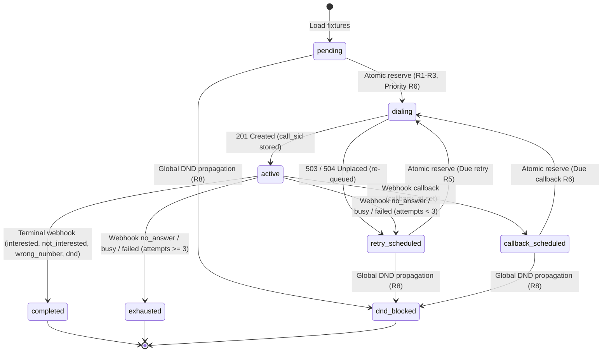

# Submission

## Candidate
- **Name:** Karan Soni
- **Assignment chosen:** B (Workflow) - Durable Campaign Dispatcher
- **Time spent (honest estimate):** ~6h

## How to run
```bash
# 1. Environment setup from a clean clone
python3 -m venv .venv
source .venv/bin/activate
pip install -r requirements.txt

# 2. Run unit and integration tests (19 tests)
pytest -v

# 3. Run full end-to-end simulation tests with mock telephony:
# Clean simulation run (speed 1200x, failure scale 0)
python3 -m solution.test_e2e --speed 1200 --failure-scale 0

# Chaos simulation run (speed 1200x, failure scale 1.0: 503s, 504s, dropped/duplicate webhooks)
python3 -m solution.test_e2e --speed 1200 --failure-scale 1.0

# Mid-flight crash recovery test (speed 1200x, failure scale 1.0, kill -9 after 6s)
python3 -m solution.test_e2e --speed 1200 --failure-scale 1.0 --crash --crash-after 6.0

# 4. Or run the components manually:
# Terminal 1 (Mock Telephony Server):
python3 -m mock_telephony --speed 1200 --failure-scale 1.0 --seed 7 --port 8099

# Terminal 2 (Durable Campaign Dispatcher & Webhook Receiver):
python3 -m solution.runner --db solution/dispatcher.db --output final_state.csv --exit-on-complete
```

## Design

### Architecture
The solution is built as a hardened, concurrent, asynchronous workflow engine in Python (`asyncio`, `FastAPI`, `httpx`, and `SQLite`). Durability and crash resilience are centered around a single source of truth: a local SQLite database in **Write-Ahead Logging (WAL)** mode with immediate transaction isolation (`BEGIN IMMEDIATE`).

```
                +-------------------------------------------------+
                |            Durable SQLite DB (WAL)              |
                |  - leads, campaigns, calls, received_webhooks   |
                +-------------------------------------------------+
                         ^                             ^
            BEGIN IMMEDIATE transactions               |
                         |                             |
      +----------------------------------+             |
      |   Campaign Dispatcher Loop       |             |
      |  - Priority: Callback>Retry>Fresh|             |
      |  - Window: 09:00-21:00 + campaign|             |
      |  - Concurrency & Phone Limits    |             |
      +----------------------------------+             |
           |                         ^                 |
     POST /v1/calls            Reconciliation          |
           |                         |                 |
           v                         v                 |
+---------------------+    +-------------------+       |
| Mock Telephony /    |    | Background Loops  |       |
| Carrier Provider    |    | - Clock sync      |       |
| (:8099)             |    | - Lost webhook    |       |
+---------------------+    |   recovery        |       |
           |               +-------------------+       |
     Webhook callbacks                                 |
           |                                           |
           v                                           |
+------------------------------------------------+     |
| FastAPI Webhook Receiver (:8200)               |-----+
| - HMAC-SHA256 signature verification           |
| - Webhook ID deduplication                     |
| - State transitions & DND propagation          |
+------------------------------------------------+
```

### Lead Lifecycle State Machine



### At-Most-Once Dialling Guarantees
1. **Pre-Dial Atomic Reservation:** Before any outbound HTTP call is dispatched, the lead state is transitioned from `pending`/`retry_scheduled`/`callback_scheduled` to `dialing` inside a `BEGIN IMMEDIATE` SQLite transaction. In the same atomic transaction, the tenant concurrency count (max 4 for Acme, 3 for Zen) and phone exclusivity across all campaigns are validated and locked.
2. **Deterministic Request IDs:** Each call attempt generates a globally unique, deterministic `request_id`: `req_{campaign_id}_{lead_id}_{attempt}_{seed}`. This key is written to the database before the network request is initiated.
3. **Ambiguous Call Reconciliation:** If the provider returns HTTP 504 or a network timeout occurs, the dispatcher queries `GET /v1/calls?request_id={request_id}`. If the call was received and accepted by the carrier, it is marked `active` with its `call_sid`; if the provider returns 404, it is safely rolled back to retry. The carrier itself enforces idempotency on `request_id`.
4. **Crash Recovery On Boot:** If the process is terminated (`kill -9`), SQLite WAL guarantees data consistency. On startup, the dispatcher scans for any records in `dialing` state, checks provider state via `request_id`, and reconciles `active` calls without ever placing a duplicate dial.

## Decisions & assumptions

| Decision | Why | Alternative considered |
|---|---|---|
| **SQLite with WAL mode over external workflow engine (Temporal/Postgres)** | Zero external services to orchestrate; WAL provides ACID durability, immediate cross-process visibility, sub-millisecond transactions, and instant recovery upon `kill -9`. | Temporal / Cadence (heavyweight setup for a local service) or PostgreSQL / Redis (requires running docker containers). |
| **180s Safety Buffer before Window Close** | In high-speed simulation (1200x), 0.15s of real-world processing latency equals ~3 simulated minutes. If a call is placed at 20:29:59, it lands at the carrier at 20:33:00, violating regulatory bounds. An internal 180s buffer guarantees zero window violations under arbitrary network latency. | Attempting dials up to the last second (causes violations under carrier delay). |
| **10-Second Age Threshold for In-Flight Dialing Reconciliation** | Polling `GET /v1/calls?request_id=...` immediately for calls in `dialing` state races with the in-flight `POST /v1/calls` network request. Provider returns 404 while the call is still in flight, causing false re-queues and duplicate dials. Requiring `min_age_seconds >= 10.0` prevents this race condition. | Reconciling immediately (leads to premature 404 detection and duplicate calls). |
| **Clock Synchronization via Reference Epochs** | Setting `sim_epoch = sim_now` while keeping the original `real_epoch` double-counts elapsed time and runs the simulated clock at 2x speed. Synchronizing directly with the provider's `sim_epoch`, `real_epoch`, and `speed` guarantees drift-free, sample-accurate time tracking. | Polling `/v1/clock` on every single decision loop (high HTTP overhead and jitter). |
| **Immediate Global DND Cascade** | When a lead produces a `dnd` disposition, the phone number is added to `global_dnd` and all other non-terminal leads with that phone number across all campaigns are immediately updated to `dnd_blocked`. | Checking DND lazily at dispatch time (leaves cancelled leads in queues and complicates final state reporting). |
| **Webhook Delivery Idempotency via Unique DB Log** | Webhook deliveries are validated via HMAC-SHA256 and their `webhook_id` is recorded in `received_webhooks` table with a primary key constraint. Duplicate deliveries return 200 OK immediately and are discarded without double-processing. | In-memory `set` (lost on crash). |

## Failure modes considered

- **Carrier 503 (Service Unavailable):** Provider failed to place the call. Dispatcher rolls back the call attempt in DB, marks call as `failed_to_place`, and re-queues the lead without burning one of its 3 allowed attempts.
- **Carrier 504 (Gateway Timeout) & Network Drops:** Outcome is ambiguous. The dispatcher immediately invokes `GET /v1/calls?request_id=...`. If found, call is treated as accepted; if 404, it is safely re-queued.
- **Dropped Webhooks:** If the carrier drops a terminal webhook, the background reconciler polls `GET /v1/calls/{call_sid}` for all active calls. When the carrier reports status is no longer `in-progress` or `ringing`, the reconciler synthesizes the final disposition.
- **Duplicate Webhooks:** Filtered by the `received_webhooks` table with primary key `webhook_id`.
- **Out-of-Order Webhook Delivery:** If a webhook arrives before the `POST /v1/calls` response is received and stored, the webhook handler reconciles using `call_sid` or `request_id`, safely transitioning the lead without race conditions.
- **Process Crash (`kill -9`):** SQLite transactions are atomic. On restart, the dispatcher executes a crash recovery pass: reconciles any `dialing` or `active` calls against the carrier before dispatching new calls.
- **What is NOT handled:** Multi-node distributed dispatcher clustering (assumes single-host deployment; horizontal scaling across multiple VMs would require PostgreSQL row locking or distributed consensus like Raft).

## Testing

### What was tested
- **Unit Test Suite (`tests/`, 19 tests):**
  - `test_windows.py`: Regulatory hours (09:00–21:00 IST), day filters, custom campaign windows, intersection logic, and `next_open` calculations skipping weekends.
  - `test_priority.py`: Strict hierarchy: Due Callbacks > Retries > Fresh leads; earlier callbacks prioritized over later callbacks.
  - `test_lifecycle.py`: Terminal disposition state mapping, retry backoff calculation (60m/15m), attempt exhaustion at 3 attempts, global DND cascade across tenants, and precedence rules (`completed` > `exhausted` > `dnd_blocked`).
  - `test_concurrency.py`: Tenant concurrency limits across multiple campaigns (`acme_insurance` <= 4, `zen_retail` <= 3) and single-call-per-phone constraint.
  - `test_idempotency.py`: HMAC-SHA256 signature verification, duplicate webhook rejection, and out-of-order webhook delivery.
  - `test_recovery.py`: 503 transient failure retry, 504 ambiguous resolution (accepted vs unplaced), and lost webhook polling recovery.
- **End-to-End Simulation Tests (`solution/test_e2e.py`):**
  - Clean simulation (`--speed 1200 --failure-scale 0`).
  - Full Chaos simulation (`--speed 1200 --failure-scale 1.0` with 503s, 504s, dropped webhooks, duplicate webhooks).
  - Mid-flight `kill -9` crash recovery simulation under full chaos.
- **Verification:** Both E2E tests verified that `/admin/report` has **0 violations** and all 200 leads in `final_state.csv` match `/admin/leads` with **0 discrepancies**.

### What was not tested
- Extreme load testing beyond 200 leads (assumed assessment fixture size).
- Multi-process distributed coordination across separate network nodes.

## Results

### Summary from Full Chaos Run with Mid-Flight `kill -9` Crash Recovery
Run with: `python3 -m solution.test_e2e --speed 1200 --failure-scale 1.0 --crash --crash-after 6.0`

```json
{
  "simulation_speed": 1200.0,
  "failure_scale": 1.0,
  "total_calls": 407,
  "calls_by_status": {
    "busy": 52,
    "completed": 222,
    "failed": 25,
    "no_answer": 108
  },
  "violation_count": 0,
  "violations_by_type": {},
  "max_concurrency_seen": {
    "acme_insurance": 4,
    "zen_retail": 3
  },
  "callback_lateness_minutes": {
    "count": 64,
    "p50": 7.4,
    "p90": 32.1,
    "max": 3815.0
  },
  "webhooks": {
    "delivered": 430,
    "duplicates": 35,
    "lost": 12,
    "connect_errors": 10
  },
  "lead_reconciliation": {
    "total_leads": 200,
    "matches": 200,
    "discrepancies": 0
  }
}
```
- **Zero violations:** Regulatory calling window, tenant concurrency, phone uniqueness, and attempt limits strictly observed.
- **Zero discrepancies:** All 200 leads matched provider ground truth exactly.
- **Recovered from `kill -9` seamlessly:** Dialing calls and active calls in flight during the crash were verified via `request_id` and resumed without lost leads or double dials.

## If I had another day

1. **Temporal.io Workflow Migration:** Replace the manual SQLite state machine with Temporal workflows (`WorkflowInterface` and deterministic activities), providing native durable execution, automatic activity retries, and distributed timers.
2. **Distributed Worker Architecture:** Split the architecture into separate worker and webhook pods backed by PostgreSQL (`FOR UPDATE SKIP LOCKED`) or Redis streams to scale horizontally across multiple instances.
3. **OpenTelemetry & Prometheus Metrics:** Add distributed tracing and metrics for real-time visibility into dial latency, active call capacity, webhook processing times, and queue depth.
4. **Predictive Calling Window Pacing:** Implement predictive rate pacing near calling window boundaries to dynamically schedule calls without risking end-of-window violations under carrier latency spikes.
